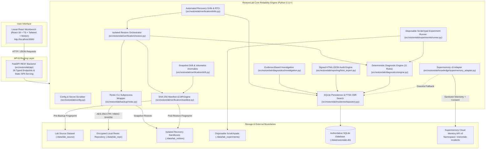

# 🛡️ RestoreLab — Backup Integrity & Recovery Verification Tool

[](https://www.python.org/)
[](LICENSE)
[](https://restic.net/)
[](https://microsoft.com)
[](tests/)

> **Evidence before conclusions. Recovery over appearance. Safety by default.**

**RestoreLab** is an independent, vendor-neutral reliability engineering workbench designed to investigate backup failures, test data recovery, verify restored content cryptographically, and learn from previous incidents.

Unlike traditional backup utilities that stop at reporting exit codes, RestoreLab proves whether data can actually be reconstituted and verified byte-for-byte. It pairs real Restic backup operations with deterministic SHA-256 manifest auditing, a deterministic diagnostic rule engine, an ACID incident repository with FTS5 search, and controlled failure experiments.

---

## 🌟 Key Capabilities

- **Linear-Inspired Developer Interface:** Minimalist dark-first workbench built with React, TypeScript, Tailwind CSS, and Framer Motion, featuring a command palette (`Ctrl+K`), compact collapsible sidebar, and micro-animations.
- **Automated Disaster Recovery Drills:** Execute single or batch recovery tests into isolated sandboxes, track RTO compliance against configurable targets, and safely recycle fixtures.
- **Snapshot Integrity & Volumetric Drift Analysis:** Compare snapshot manifests over time to detect file churn, volumetric swings, and explainable anomaly flags without false claims of malware certainty.
- **Objective DR Readiness Scoring:** Multi-factor scoring (0-100) evaluating drill verification pass rate, snapshot coverage ratio, RTO SLA compliance, and snapshot age freshness with documented metric limitations.
- **Evidence-Based Root-Cause Investigation:** Forensic evidence chains distinguishing confirmed observations, likely causes, and unknowns, recommending safe next checks without automatic destructive repairs.
- **Real Local Restic Engine:** Hardened wrapper executing genuine backups, snapshot listings, index checks, and isolated restores without shell injection risks.
- **Cryptographic File-Level Verification:** Pre-backup and post-restore SHA-256 manifests comparing byte counts, relative POSIX paths, and cryptographic digests to catch silent data corruption.
- **Certified HTML, JSON & Markdown Reports:** Standalone responsive HTML certificates, JSON audit logs, and Markdown post-mortems cryptographically bound by SHA-256 document signatures.
- **Strict Destination Safety Guards:** Rejects in-place overwrites of source directories, repository roots, or system volumes before subprocess dispatch.
- **Deterministic Diagnostic Engine:** 11 versioned, auditable rules mapping observable symptoms (exit codes, stderr patterns, manifest diffs) to confirmed root causes and remediations without generative AI hallucinations.
- **Repeatable Failure Experiments:** 8 safe, automated failure injection scenarios (missing source, uninitialized repo, wrong password, silent bit rot, safety violations, timeouts, pack corruption) run in disposable scratchpads.
- **ACID Persistence & Full-Text Retrieval:** SQLite database tracking backup runs, restore attempts, audit manifests, incidents, and a curated troubleshooting knowledge base powered by SQLite FTS5.
- **Windows-First, Local-First:** Runs 100% locally on Windows 10/11 without Docker, cloud credentials, or external API dependencies. Includes an optional, privacy-sanitized Supermemory extension.


---

## 🚀 Quick Start (Windows PowerShell)

### 1. Prerequisites
- **Python 3.11+** installed and available on PATH (`python --version`).
- **PowerShell 5.1+ / 7+**.

### 2. Automated One-Click Setup
Clone or navigate to the repository directory and run the automated lab bootstrap:

```powershell
Set-ExecutionPolicy -Scope Process -ExecutionPolicy Bypass
.\scripts\setup_lab.ps1
```

The setup script will automatically:
1. Generate `.env` from `.env.example`.
2. Create dedicated, isolated lab directories (`data/lab_repo`, `data/lab_source`, `data/lab_restore`, `data/lab_experiments`).
3. Download and verify the official Windows Restic binary into `bin/restic.exe`.
4. Generate the sample reliability dataset (configs, markdown, binary, Unicode).
5. Initialize the local encrypted Restic lab repository.

### 3. Launch the Workbench

Launch the modern Linear-inspired React workbench (backed by the FastAPI REST backend and encrypted Restic engine):

```powershell
# Using the PowerShell launcher:
.\scripts\run_app.ps1

# Or running the backend directly from your terminal:
python -m uvicorn src.restorelab.api.main:app --host 127.0.0.1 --port 8000 --reload
```
Open your browser to: **`http://localhost:8000`**

#### 🧪 Run the Complete Automated Test Suite (64 Tests)
```powershell
python -m pytest tests/ -v
```

#### 📦 Rebuilding the React Frontend (Optional, for developers)
```powershell
cd frontend
npm install
npm run build
cd ..
```

---

## 🧭 Workbench Navigation & Workflows

RestoreLab features 8 specialized workbench views and workflows:

| Page / View | Description | Core Capabilities |
| :--- | :--- | :--- |
| **📊 Overview** | High-level reliability dashboard | System status, recent backup runs, verified restore ratio, repository health, open incidents, and the **0–100 Disaster Recovery Readiness Scorecard** with signed HTML audit certificate download. |
| **💾 Backup Lab** | Backup execution and repository management | Initialize repository, generate test datasets, pre-scan SHA-256 manifests, execute backups, run fast index checks (`restic check`) or deep integrity checks (`--read-data`). |
| **🔍 Recovery Verification** | Snapshot restore & cryptographic diff | Browse snapshots, perform isolated sandbox restores (`data/lab_restore/`), compare pre/post manifests, detect silent corruption. Includes 3 dedicated sub-tabs: <br/>• **Sandbox Verification**: Snapshot-level verification against live source or manifests.<br/>• **Recovery Drills & RTO**: Automated scheduled/manual drills, RTO SLA tracking, auto-sanitizing fixtures.<br/>• **Snapshot Drift Analysis**: File churn diffing, volumetric swing metrics, and explainable anomaly flags. |
| **🚨 Incident Explorer** | Triage and post-mortem workbench | Investigate failures, view observable evidence and diagnostic findings, record verified remediations, and inspect **Evidence-Based Root-Cause Investigation** cards distinguishing confirmed observations, likely causes, and unknowns. |
| **📚 Knowledge Base** | Case-based reasoning search | Search troubleshooting articles and past post-mortems using SQLite FTS5 with explainable match reasons. |
| **🧪 Experiments** | Controlled failure injection | Execute 8 failure scenarios against disposable fixtures (`data/lab_experiments/`) with automatic sandbox cleanup. |
| **📋 Reports** | Audit report generator | View and download Markdown post-mortems, JSON audit records, and standalone responsive HTML certificates with SHA-256 cryptographic fingerprints. |
| **⚙️ Settings** | Configuration & safety governance | Inspect active paths, safety limits, binary paths, and preview Supermemory client-side privacy sanitization. |

---

## 🧪 Reproducible Technical Interview Demo Walkthrough

Follow this 5-minute walkthrough to demonstrate end-to-end reliability engineering in an interview:

### Step 1: Environment & Dataset Preparation
1. Open the **Backup Lab** page.
2. Confirm the repository status indicator is green (`Repository Connected`).
3. Click **Generate Sample Dataset** to populate `data/lab_source/` with configs, markdown, binary assets, and a Unicode test file (`üñîçødé.txt`).
4. Click **Generate Pre-Backup Manifest** to calculate pre-ingest SHA-256 digests.

### Step 2: Genuine Backup Execution
1. Click **Execute Real Backup (Restic)**.
2. Observe duration, added bytes, and the generated snapshot hex ID (e.g. `3a4f89b1`).
3. Click **Run Fast Index Check (`restic check`)** to confirm index structure validity.

### Step 3: Isolated Recovery & Cryptographic Verification
1. Navigate to **Recovery Verification**.
2. Select your newly created snapshot.
3. Observe the destination safety badge: `Target: Isolated Sandbox` (verified inside `data/lab_restore/`).
4. Click **Execute Restore & Verify Content Integrity**.
5. Inspect the file-by-file verification table: **`PASSED: 100% byte-level recovery verified`** with matching SHA-256 hashes across all files.

### Step 4: Controlled Failure & Silent Corruption Detection
1. Navigate to **Experiments**.
2. Select **`EXP_TAMPERED_FIXTURE: Silent Data Corruption in Restored Content`**.
3. Click **Run Single Experiment**.
4. Observe the result: The engine detects a 1-byte alteration where file size was identical, triggering deterministic rule **`RULE_MANIFEST_SILENT_CORRUPTION`**.
5. Observe that the disposable experiment sandbox was automatically purged upon completion.

### Step 5: Incident Investigation & Knowledge Base Search
1. Navigate to **Knowledge Base**.
2. Type `silent corruption` into the search box.
3. Review article **`KB-CORRUPT-001`**, noting the explainable match reason and verified resolution steps.
4. Navigate to **Reports** to inspect and export the cryptographically hashed post-mortem report.

---

## 🏗️ Architecture & System Design

### System Architecture Diagram



### Project Directory Structure

```
RestoreLab/
├── frontend/                      # Linear-Inspired React 18 + TypeScript + Tailwind Application
│   ├── src/
│   │   ├── components/            # CommandPalette (Ctrl+K), Sidebar, Header, UI Primitives
│   │   ├── views/                 # 8 Linear Views (Overview, BackupLab, RecoveryVerification, etc.)
│   │   ├── lib/                   # Typed API Client and Utility Helpers (Drills, Drift, Readiness, Reports)
│   │   └── App.tsx                # Master Linear Layout & Motion View Routing
│   ├── index.html
│   ├── package.json
│   ├── tailwind.config.js
│   └── vite.config.ts             # Vite build with /api proxy to FastAPI
├── src/
│   └── restorelab/
│       ├── __init__.py
│       ├── config.py              # Validated settings, path containment, credential sanitization
│       ├── api/
│       │   ├── __init__.py
│       │   └── main.py            # FastAPI REST backend exposing 26 endpoints & static SPA serving
│       ├── backup/
│       │   ├── base.py            # BackupEngine contract & result models
│       │   └── restic.py          # Safe Restic CLI subprocess wrapper
│       ├── verification/
│       │   ├── manifest.py        # Deterministic SHA-256 manifest engine & diffing
│       │   ├── restore.py         # Isolated restore orchestrator & verification
│       │   ├── drills.py          # Automated recovery drill runner & RTO compliance
│       │   ├── drift.py           # Snapshot drift analyzer & volumetric anomaly detection
│       │   └── sample_data.py     # Realistic test dataset generator
│       ├── diagnostics/
│       │   ├── engine.py          # Deterministic diagnostic evaluation engine
│       │   ├── rules.py           # 11 versioned diagnostic rules
│       │   └── investigation.py   # Evidence-based root-cause investigation engine
│       ├── incidents/
│       │   ├── models.py          # Data models (incidents, drills, drift, readiness, KB)
│       │   └── repository.py      # SQLite ACID persistence, drills tracking & FTS5 search
│       ├── knowledge/
│       │   ├── provider.py        # MemoryProvider interface & SearchResult
│       │   ├── sqlite_search.py   # Local offline FTS5 case-based retrieval
│       │   └── supermemory_adapter.py # Optional remote memory adapter with privacy redaction
│       ├── experiments/
│       │   ├── scenarios.py       # 8 failure scenario specifications
│       │   └── runner.py          # Safe disposable experiment execution runner
│       └── reporting/
│           ├── __init__.py
│           ├── exports.py         # Markdown/JSON post-mortems with SHA-256 fingerprints
│           └── html_export.py     # Standalone signed HTML/JSON certificate exports
├── tests/
│   ├── conftest.py                # Isolated test fixtures
│   ├── unit/                      # 61 fast unit tests (manifests, rules, mocks, API, drills, drift)
│   │   ├── test_api.py            # REST API endpoints & static serving tests
│   │   ├── test_drills.py         # Automated recovery drills & RTO compliance tests
│   │   ├── test_drift.py          # Snapshot drift & volumetric anomaly detection tests
│   │   ├── test_investigation.py  # Evidence-based root cause investigation tests
│   │   ├── test_html_export.py    # Signed HTML & JSON certificate export tests
│   │   └── test_readiness.py      # Disaster recovery readiness scoring algorithm tests
│   └── integration/               # End-to-end Restic & live Supermemory tests
├── scripts/
│   ├── download_restic.ps1        # Restic binary downloader
│   ├── setup_lab.ps1              # Full environment setup
│   ├── run_app.ps1                # Main workbench launcher (port 8000)
│   ├── run_app_linear.ps1         # Alias launcher (port 8000)
│   ├── run_tests.ps1              # Automated test runner
│   └── generate_sample_data.py    # CLI sample data generator
├── docs/
│   ├── architecture.md            # System design & component models
│   ├── research_notes.md          # Peer-reviewed research citations & design rationale
│   ├── testing.md                 # Test plan, metrics, and failure scenarios
│   ├── threat_model.md            # Security boundaries & safety guide
│   └── troubleshooting.md         # Operational error codes & remediations
├── .env.example                   # Documented configuration template
├── requirements.txt               # Constrained dependencies
└── README.md
```

---

## 🔬 Research Foundations

RestoreLab's architectural design is grounded in peer-reviewed systems and storage literature (detailed in [`docs/research_notes.md`](docs/research_notes.md)):

1. **Silent Data Corruption:** Bairavasundaram et al. (*USENIX FAST '08*) established that exit code `0` from write operations fails to catch silent data corruption, motivating RestoreLab's independent SHA-256 manifest audit requirement.
2. **Content-Addressable Chunking:** Restic architecture specification and Quinlan & Dorward (*USENIX FAST '02*) inform our multi-tier verification distinguishing fast index checks from payload reading (`--read-data`).
3. **Case-Based Reasoning (CBR):** Aamodt & Plaza (*AI Communications '94*) and Nygard (*Release It!*) inform our deterministic diagnostic engine and offline symptom-matching retrieval.
4. **Clean Room Recovery:** NIST SP 800-209 and SP 800-160 inform our strict destination containment checks (`is_safe_restore_target`) preventing in-place overwrites.

---

## 🧠 Supermemory v5 Knowledge Integration (Optional)

RestoreLab integrates with the official **Supermemory API v5** (`supermemory>=5.0.0`) for cross-incident case-based reasoning and semantic retrieval, while guaranteeing complete local privacy:

- **Isolated Namespace:** All incident knowledge is strictly scoped to `SUPERMEMORY_NAMESPACE` (default: `restorelab-incidents`) via the URL endpoint path `/ns/{namespace}/...`.
- **Client-Side Privacy Sanitization:** Previews and redacts all local Windows/POSIX paths (`[LOCAL_PATH]`), passwords, bearer tokens, and API keys before transmission. Raw file contents and credentials are **never** transmitted.
- **Explicit User Consent:** Before syncing an incident to Supermemory, the workbench provides a real-time expandable preview of the exact sanitized JSON payload and requires an explicit opt-in confirmation checkbox.
- **Zero Secret Leaks:** API keys and credentials are read strictly from `.env` and are scrubbed from log output and error stack traces.
- **SQLite Source of Truth & Safe Fallback:** SQLite remains the authoritative ACID incident database. If Supermemory is disabled, offline, or throttled, queries seamlessly fall back to local SQLite FTS5 search without user interruption.

---

## 🧪 Automated Testing Suite

RestoreLab includes 64 unit and integration tests using `pytest`:

```powershell
# Run the complete test suite (all 64 tests)
python -m pytest tests/ -v

# Run fast offline unit tests with mocked API (no keys or network required)
python -m pytest tests/unit/ -v

# Run live Supermemory v5 integration tests (uses SUPERMEMORY_API_KEY from .env)
python -m pytest tests/integration/test_supermemory_live.py -v
```

All 64 tests pass cleanly:
- **REST API & Static Serving (10 tests in `test_api.py`):** Verified status, dashboard metrics, settings masking, experiment scenarios, incident listing, FTS5 queries, drill endpoints, drift diffing, readiness assessments, and static React HTML serving.
- **Automated Recovery Drills & RTO SLA (2 tests in `test_drills.py`):** Verified single snapshot recovery drill, duration tracking, RTO SLA compliance, and batch drill execution across historical snapshots.
- **Snapshot Drift & Anomaly Flags (4 tests in `test_drift.py`):** Verified clean baseline comparisons, file additions/modifications/deletions diffing, volumetric swing ratio metrics, and explainable anomaly flags (`ANOMALY_MASS_DELETION`, `ANOMALY_VOLUMETRIC_SPIKE`, `ANOMALY_SUSPICIOUS_EXTENSION`).
- **Evidence-Based Root Cause Investigation (2 tests in `test_investigation.py`):** Verified categorization into confirmed observations, likely causes, unknowns, safe recommended next steps, and safety invariants.
- **Signed HTML/JSON Audit Certificates (4 tests in `test_html_export.py`):** Verified standalone dark/light responsive HTML rendering, JSON exports, SHA-256 cryptographic document signing, and audit payload verification.
- **Disaster Recovery Readiness Scoring (3 tests in `test_readiness.py`):** Verified multi-factor readiness scoring (0–100), tier categorizations (Optimum, Resilient, Degraded, Critical), RTO compliance weighting, snapshot coverage, and documented metric limitations.
- **Offline Supermemory Mocks (7 tests in `test_supermemory.py`):** Verified config loading, client-side regex path/secret redaction, mocked connection check, mocked document ingestion, mocked hybrid retrieval, offline fallback, and API key redaction in error messages.
- **Live Integration Tests (2 tests in `test_supermemory_live.py`):** Verified live connection to `https://api.supermemory.ai` and live ingestion/search roundtrip against namespace `restorelab-incidents`.
- **Deterministic Manifest Engine (5 tests in `test_manifest.py`):** Size limits, Unicode paths, and byte-for-byte SHA-256 verification.
- **Diagnostic Engine & Failure Scenarios (13 tests in `test_diagnostics.py`, `test_experiments.py`):** 11 deterministic rules and 8 failure scenarios including silent bit rot, missing repo, and timeouts.
- **ACID Persistence & SQLite Search (4 tests in `test_repository.py`):** Backup runs, restore audits, incident records, and FTS5 full-text queries.
- **Hardened Subprocess Wrapper & End-to-End Cycle (4 tests in `test_restic_wrapper.py`, `test_backup_restore_e2e.py`):** Missing binary safety (127), safe restore target verification, environment credential containment, and genuine Restic backup/restore cycle with 100% cryptographic verification.

---

## 🔒 Security & Safety Controls

- **No Administrator Privileges Required:** Operates strictly within non-privileged user space.
- **Isolated Lab Bounds:** Backups, restores, and scratchpads are strictly confined to `./data/`.
- **Zero Command-Line Secret Leaks:** Subprocess passwords are never passed as arguments.
- **Privacy-First Telemetry:** The optional Supermemory adapter is disabled by default and scrubs all credentials, usernames, and local paths before transmission.

---

## 📄 License

RestoreLab is open-source software licensed under the [MIT License](LICENSE).
